# Roadmap: Swag — платформа роёв агентов

Swag — от swarm + agent.

Версия от 2026-10-27. Идея и история решений — [COMPLETE_CHAT_HISTORY.md](COMPLETE_CHAT_HISTORY.md).

## Суть продукта

Пользователь ставит задачу — платформа на лету собирает под неё рой агентов:
- каждый агент работает в своей песочнице (контейнер, позже microVM), песочницы поднимаются за доли секунды;
- агенту подключаются скиллы из общего реестра — по смыслу задачи;
- агенты общаются через шину, изолированную на уровне роя: рой A не видит рой B;
- всё видно в UI. Главная метрика для пользователя — **сколько денег тратится**, в реальном времени, по рою, агенту и шагу.

Кто работает с платформой:
- **Компания (организация)** — регистрируется сама и получает личный кабинет: общий баланс и баланс ИИ, свои процессы, рои, чат-боты и их расходы. Работает по предоплате. Чужие организации не видит.
- **Администратор организации** — тот, кто зарегистрировал компанию: управляет её пользователями, ролями, балансом, процессами и расходами.
- **Пользователь** — сотрудник компании: работает с процессами организации в пределах своих прав.
- **Супервизор** — владелец платформы, один или несколько. Видит и управляет всей платформой: организации, пользователи, пополнение балансов, цены и лимиты, все рои и все расходы, состояние сервисов.

**Главный критерий готовности MVP** — на платформе работает [чат-бот магазина компьютеров](#целевой-кейс-mvp-чат-бот-магазина-компьютеров): бот сам ведёт диалог с покупателем до подготовки продажи и снимает с менеджеров однотипные вопросы. Рои, деньги, песочницы и редактор графа — фундамент, на котором этот бот собран.

После MVP — коннекторы к внешним системам бизнеса (CRM и др.) и каналы Telegram и VK.

## Принципы

1. **Деньги считаются с первого вызова модели**, а не достраиваются в конце.
2. **Модели — только через LLM Gateway**: агентный цикл пишется один раз на OpenAI-формате, ключи провайдеров и учёт денег — в отдельном сервисе, в песочнице ключей нет.
3. **Песочница — одноразовый вычислитель.** Источник истины — Postgres, S3 и NATS. Песочницу можно убить и поднять заново без потери данных.
4. **LLM предлагает, код исполняет.** Координатор генерирует план роя, оркестратор проверяет его и исполняет детерминированно.
5. **Изоляция роя** — и на уровне сети, и на уровне шины.
6. **В MVP только то, без чего не работает целевой кейс** — чат-бот магазина компьютеров — и лежащий под ним сценарий «задача → рой → результат → сколько стоило». Остальное — после, по данным.
7. **Ядро отдельно от оболочки.** Логика каждого сервиса и приложения — в ядре на чистом TypeScript, без фреймворков и инфраструктуры. Fastify, Angular, консоль — сменные оболочки над ядром. Подробно — [docs/architecture.md](docs/architecture.md).
8. **Доступ проверяется в ядре.** Каждая операция с данными пользователя знает, кто её вызывает, и сама решает, можно ли. Оболочка только узнаёт вызывающего по токену. Деньги пользователя не уходят в минус: рой не стартует, если бюджет больше остатка.
9. **Любой процесс прослеживается от начала до сбоя.** Запрос пользователя получает `traceId`, который проходит через все сервисы, шину и песочницы; логи структурные и несут `traceId`, `swarmId`, `agentId`. По ошибке видно, что именно происходило до неё и где. Закладывается сразу после скелета, а не после MVP.

## Сущности платформы

Кирпич платформы — **агент**. Компания собирает из узлов **процесс** — [граф](#4-граф-процесса), который описывает словами или строит в визуальном редакторе. Рой и чат-бот — два вида процесса, они различаются тем, что их запускает, и жизненным циклом: рой запускает задача, чат-бота — триггер канала (новое сообщение в диалоге). Это трактовка, D-28 в [questions.md](docs/spec/questions.md).

### Агент

Агент — исполнитель с параметрами запуска и результатом. Агенты бывают двух видов:

- **LLM-агент** — роль, системный промпт, модель, скиллы, инструменты, лимиты; работает агентным циклом через LLM Gateway;
- **программа** — детерминированный вычислитель без модели: скрипт с описанными параметрами запуска и конкретным выходом. Пример — расчёт цены: стоимость из внешней системы плюс надбавка за работу по формуле.

Программа — такой же узел процесса, как LLM-агент: её ставят в рой и вызывают из чат-бота. Это прямое следствие принципа 4: что можно посчитать кодом, считает код, а не модель. Оба вида исполняются в песочнице — `SandboxProvider` не знает, что именно запускает, — и пишут стоимость в ledger: LLM-агент — вызовы модели и compute, программа — только compute.

Агентный цикл не знает, работает он в рое или в чат-боте. На вход он получает контекст вызова — кто вызвал, бюджет, история, инструменты, — на выход отдаёт шаги и результат. Закладывается с этапа 2, когда цикл пишется впервые.

### Рой

Рой — команда агентов, которая поднимается под задачу: цель → граф → результат → уборка. Рой — это [граф процесса](#4-граф-процесса): узлы — LLM-агенты и программы, рёбра — поток данных или связь «кто кому пишет». Граф строит координатор по описанию или пользователь в визуальном редакторе.

**Рой как узел графа.** Рой — сохранённая команда: агенты, их роли и связи, — которая инкапсулирует работу и сама становится узлом другого графа процесса. Снаружи у узла-роя один вход и один выход: работа приходит агенту-входу, результат выходит его `finish`. Внутри агенты передают работу друг другу через шину сами. Рой спит, пока работы нет. Пришла работа — событием триггера или выходом соседнего узла — рой активируется: песочницы поднимаются, команда делает работу, отдаёт результат, ресурсы освобождаются, рой снова неактивен. Следующее событие активирует его заново. Определение роя хранится отдельно от активаций, у каждой активации свои события, стоимость и трейс. Одна активация — то, что делает спека 022; определение, триггеры и вложенность — 009, быстрый подъём — тёплый пул 005. Открытые вопросы концепции — D-77.

### Чат-бот и диалог

**Чат-бот** — процесс, не привязанный к рою: долгоживущая настройка компании. В неё входят стиль общения, системные промпты, регламенты и документы, каналы связи и источники внешних данных. В графе это узлы: триггер канала → LLM-агент диалога → коннекторы и программы → ответ в канал. Чат-бот принадлежит организации, а не пользователю.

**Диалог** — переписка бота с одним собеседником в одном канале. Диалог хранит сжатую историю, состояние («ведёт бот», «у менеджера», «закрыт») и ожидаемые результаты — ответ роя или программы.

Из диалога бот может:

- ответить сам;
- вызвать программу — например, поиск и расчёт стоимости;
- поставить задачу рою — ответ асинхронный, бот пишет «уточню и вернусь», результат роя приходит в диалог событием;
- передать диалог менеджеру — тогда процесс бота не поднимается, сообщения только записываются.

### Жизненный цикл процесса чат-бота

Диалог живёт днями, процесс агента — минутами. Следующее сообщение может прийти через минуту, завтра или никогда, поэтому процесс одноразовый, а всё значимое хранится вне его — принцип 3 для бота становится нормой работы, а не аварийным случаем.

1. **Пробуждение.** Пришло сообщение или событие диалога (результат роя или программы) → процесс берётся из тёплого пула и получает профиль бота и id диалога. Процесс не закреплён за ботом: это обезличенный исполнитель, которому выдали роль.
2. **Восстановление.** Из Postgres подгружаются сводка и последние сообщения диалога, его состояние и журнал инструментов. Если с прошлого сообщения прошло время, в историю добавляется сообщение «пауза с T1 до T2, данные могли устареть» (раздел 6): цены и наличие перед ответом перечитываются.
3. **Работа.** Каждое сообщение пишется в Postgres до следующего шага.
4. **Горячее окно.** После ответа процесс живёт ещё N минут, чтобы быстрый ответ покупателя не платил за восстановление. N — параметр бота, значение по умолчанию — по замерам.
5. **Усыпление.** Окно истекло → процесс убивается, ресурсы освобождаются, диалог остаётся открытым.
6. **Закрытие диалога** — отдельный таймер: нет сообщений M дней → диалог закрыт.

**Регулярное сжатие контекста.** Бот не держит в контексте и не хранит всю историю диалога. Старая часть переписки регулярно сворачивается в сводку — по объёму и при усыплении, а не только при переполнении окна модели. Агент получает сводку и последние сообщения. Срок хранения исходных сообщений и нужен ли их аудит — решаем в спеке этапа 11а.

**Что ещё должен закрыть процесс бота:**

- **висящий вызов инструмента** при убийстве процесса — журнал инструментов этапа 8;
- **несколько сообщений подряд** — очередь на диалог: один активный процесс на диалог, сообщения по порядку;
- **гонка с усыплением** — аренда (lease): процесс держит диалог, пока продлевает аренду; сообщение без живой аренды будит новый процесс;
- **холодный prompt caching** после паузы — первый ответ дороже; стоимость видна в ledger по диалогу.

Ресурсы чистит тот же reaper, что и для роёв (этап 6), — по простою и истёкшей аренде, а не только по завершению роя.

## Целевой кейс MVP: чат-бот магазина компьютеров

MVP готов, когда этот кейс работает на платформе (этапы 11а–11в): бот снижает нагрузку на менеджеров и сам ведёт диалог с покупателем до подготовки продажи — подбирает варианты, называет цены по регламенту и передаёт менеджеру готового к покупке клиента. По кейсу проверяем, что этапы ведут к реальной пользе для бизнеса.

**Ситуация.** Небольшой магазин продаёт компьютеры и комплектующие. Покупатели постоянно пишут в чат на Авито: есть ли в наличии, сколько стоит, что собрать под задачу и бюджет. Отвечает менеджер, вопросы однотипные — его нужно разгрузить.

**Решение.** Магазин создаёт на платформе [чат-бота](#чат-бот-и-диалог): задаёт стиль общения, системные промпты, регламенты (наценка, гарантия, сроки сборки, что можно обещать, когда звать менеджера), подключает канал Авито и источник цен. На вопрос покупателя бот подбирает конфигурации и комплектующие с ценами, собирает несколько вариантов и даёт краткий содержательный ответ. Вопрос вне регламента или просьба позвать человека — передаёт диалог менеджеру.

**Каналы — плагины.** Общий порт канала: входящее сообщение → процесс агента бота → ответ в тот же диалог. Первая реализация — Авито. Telegram и VK — следующие адаптеры за тем же портом, ядро о конкретной площадке не знает.

**Склад и цены.** Источник — любая внешняя система учёта за общим портом каталога: поиск товара, наличие, цена. В MVP у порта один адаптер только на чтение (этап 11б); подключение произвольных систем через Managed MCP — этап 12 после MVP. У этого магазина своей системы нет: менеджер смотрит цены на сайте DNS и добавляет стоимость сборки. Варианты доступа к каталогу DNS — парсинг сайта или готовые библиотеки сообщества (по тегам `dns-shop-api`, `dns-parser`, `dns-configurator`). Выбор делаем по надёжности и условиям использования сайта.

**Расчёт цены — программа, а не модель.** Поиск и подсчёт стоимости — отдельный узел-[программа](#агент): на входе найденные позиции, на выходе цена по формуле «стоимость из внешней системы + надбавка за сборку по регламенту». Бот вызывает программу и пересказывает результат, сумму сам не считает.

---

## Архитектура



Исходник диаграммы — [docs/architecture.mmd](docs/architecture.mmd) (Mermaid). Устройство кода (ядра, оболочки, порты, адаптеры) — [docs/architecture.md](docs/architecture.md).

Песочницам доступны только LLM Gateway и своя шина: выхода в интернет и к другим роям нет.

### 1. LLM Gateway и LiteLLM — единый формат и учёт денег
- **LLM Gateway — отдельный сервис**, единственная точка выхода к моделям для всех агентов: роёв и чат-ботов. Агенты обращаются только к нему, LiteLLM и провайдеры стоят за ним.
- **Ключи провайдеров живут только в gateway** (позже — в vault). Песочницы, оркестратор и `api` их не видят.
- **Учёт денег не зависит от того, кто ходит к провайдеру.** Gateway сам проверяет бюджет до вызова, считает стоимость по `usage` ответа по ценам платформы и пишет вызов в ledger и в поток событий. Обойти учёт нельзя ни из кода агента, ни сбоем или заменой LiteLLM.
- **LiteLLM — адаптер форматов провайдеров** за gateway, его можно заменить. Виртуальные ключи и бюджеты LiteLLM не используются (D-21, детали — Q-1 [спеки 002](docs/spec/002-llm-gateway.md)).
- Агентный цикл пишется один раз на OpenAI-совместимом API (`messages`, `tools`, `tool_calls`, streaming) обычным OpenAI SDK. LiteLLM переводит запросы к Anthropic, Gemini, DeepSeek и локальным моделям. Модель агента — строка в плане роя, список моделей и fallback — в `litellm_config.yaml`.
- Цикл обрабатывает 4 сценария ответа модели: только текст; один `tool_call`; параллельные `tool_calls` (`Promise.all`); текст + `tool_calls`.
- Оркестратор при старте роя **регистрирует его в gateway**: `swarmId`, агенты (у чат-бота — бот и диалог), модели из плана, лимит агента и лимит роя. Вызов не из регистрации или к модели не из плана gateway отклоняет. При завершении роя регистрация закрывается. Агенты ходят в gateway с внутренним токеном платформы: к провайдеру с ним не пройти. Ключа на агента нет, пока недоверенный код не работает в песочнице агента (004, Q-2).
- Перед вызовом gateway атомарно резервирует максимум стоимости (входные токены + `max_tokens` × цена) из бюджетов агента и роя, после ответа закрывает резерв фактом по `usage`, включая cached tokens. Вызов сверх бюджета отклоняется до обращения к провайдеру. Правило списания для оборванного потока без `usage` — в спеке этапа 4.
- **Логи трат LiteLLM — только для сверки.** Ledger gateway регулярно сравнивается с ними и со счетами провайдера — отсюда критерий ±1%. Пропадут логи — сломается сверка, а не учёт.
- Стоимость compute (секунды песочницы × тариф) пишет оркестратор в тот же ledger.
- **Окружения dev и prod.** Для разработки и тестов — бесплатные или дешёвые провайдеры моделей, для прода — целевые. Переключение — сменой профиля конфигурации LiteLLM и `.env`, без правки кода: агентный цикл видит только имя модели. Общий роутер платформы в dev и prod — OpenRouter: в dev бесплатные модели, в prod платные (Q-2 спеки 002).
- **Резервные провайдеры.** В prod общий доступ не зависит от одного роутера: у каждой модели платформы есть резервный путь к провайдеру напрямую или через другой роутер, LiteLLM переключается на него при отказе основного. Модель платформы и её тариф при этом не меняются. Какие провайдеры, правила переключения и учёт фактической стоимости резерва — D-39.

### 2. Песочницы
- Песочница — универсальный одноразовый вычислитель, а не только место для агента. В ней можно выполнить любую работу: агента, скрипт, сборку, тесты, тяжёлый инструмент агента отдельно от его собственной песочницы. Что запускать, задают шаблон окружения и команда; `SandboxProvider` про агентов не знает.
- Общий интерфейс `SandboxProvider` (`create`, `exec`, `stop`, `stats`). Первая реализация — Docker (dockerode), на Linux-сервере — с рантаймом gVisor (`runsc`), на машине разработки — обычный `runc`. После MVP — microVM за тем же интерфейсом.
- Скорость — **тёплый пул** заранее созданных контейнеров из одного образа.
- Ограничения: `NanoCpus`, `Memory`, `PidsLimit`, read-only rootfs + tmpfs, non-root, `no-new-privileges`, `CapDrop: ALL`. Выход наружу закрыт, доступны только LLM Gateway и шина.
- Рантайм — Node 24 LTS везде, включая агента в песочнице. Другой рантайм (Bun) рассматриваем, только если замер покажет, что старт процесса — узкое место. Менеджер пакетов — npm workspaces. Вся система в разработке поднимается в Docker Compose.

### 3. Шина
- Сеть: `docker network create --internal swarm-<id>` на каждый рой.
- NATS: на каждый рой свой account с JWT от оркестратора. Subjects: `agent.<id>.inbox`, `swarm.broadcast`. Общее состояние — NATS KV.
- Агенты общаются только через брокер, напрямую друг к другу — нет. Поэтому каждое сообщение видит платформа: отсюда граф в UI, аудит, лимиты на переписку.

### 4. Граф процесса
Рой — это граф процесса. Граф создаётся двумя способами, и оба дают одно и то же:

- **по описанию** — координатор (LLM) строит граф из задачи пользователя;
- **визуально** — пользователь сам собирает граф в редакторе, по образцу n8n.

Граф одинаково проверяется оркестратором и показывается в одном редакторе. Сгенерированный граф пользователь может поправить руками перед запуском.

Координатор возвращает граф как structured output, проверяемый Zod:
```ts
SwarmPlan = {
  goal: string,
  budgetUsd: number,
  agents: { id, role, model, skills: string[], systemPrompt, limits: { maxSteps, maxUsd } }[],
  edges: { from, to, kind: 'flow' | 'link' }[],
  entry: agentId, exit: agentId,
}
```
**Узлы.** У каждого вида узла свои настройки, редактор показывает форму настроек по виду:

- **LLM-агент** («умный» узел) — роль, промпт, модель, скиллы, лимиты; тратит «баланс ИИ» (раздел 8);
- **[программа](#агент)** — вместо `model`, `systemPrompt` и `skills` команда, параметры запуска и схема выхода;
- **триггер** — что запускает процесс: задача пользователя, новое сообщение в канале;
- **канал** — откуда приходят и куда уходят сообщения диалога: Авито, позже Telegram и VK;
- **коннектор** — доступ к внешним данным: каталог и цены DNS, позже CRM и другие системы;
- **человек** — передача диалога менеджеру.

Позже — вложенный рой. В `SwarmPlan` список `agents` становится списком узлов с полем вида — формат решаем в спеке координатора.

**Узел — плагин с общим контрактом.** Каждый узел графа — экземпляр типа узла из реестра узлов. Новый тип добавляется пакетом, без правки ядер, редактора и координатора. Узлы MVP (канал Авито, коннектор DNS, расчёт цены, передача менеджеру) пишутся на том же публичном контракте, что и сторонние: контракт проверяется на реальном кейсе, а не на бумаге.

Тип узла описывает манифест:

- `type` и `version` (semver) — граф ссылается на `type@version`, обновление типа не меняет уже запущенные процессы;
- `kind` — вид узла из списка выше, от него зависит, какие операции узел реализует;
- `title` и `description` — для палитры редактора и каталога координатора: координатор видит каталог типов и выбирает из него, как скиллы (раздел 5);
- `settings` — схема настроек: по ней редактор строит форму, а оркестратор проверяет граф. Поля-секреты помечены и хранятся отдельно от графа;
- `credentials` — какой доступ нужен к внешней системе: ключ API, OAuth;
- `inputs` и `outputs` — схемы входа и выхода, по ним проверяются рёбра «поток»;
- `operations` (у коннектора и канала) — операции со схемами входа и выхода, размеченные `read` / `write` / `destructive`. LLM-агент, связанный с коннектором, получает его операции как инструменты;
- `egress` — к каким хостам узлу нужен выход.

Код узла видит только контекст исполнения: свои настройки, секреты по запросу через порт, HTTP через исходящий прокси со списком хостов из `egress`, логгер, хранилище состояния узла (курсор триггера, токен канала), запись стоимости в ledger. Env, файлов хоста и сети в обход прокси у него нет. Операции по видам:

- **триггер** — `start` и `stop` подписки или `poll(cursor)`, отдаёт события запуска процесса;
- **канал** — приём сообщений, как у триггера, и `send`;
- **коннектор и программа** — `execute(input) → output`, у коннектора — по операции;
- **LLM-агент и человек** — встроенные виды с тем же манифестом, исполняет их платформа: агентный цикл и очередь менеджера.

Код стороннего узла исполняется в песочнице (раздел 2), секреты клиента — в vault, в песочницу попадает только разрешённое узлу. Коннектор в виде MCP-сервера (этап 12) — второй способ исполнения того же контракта: инструменты MCP становятся `operations`. Узел распространяется npm-пакетом, SDK `@swag/node-sdk` даёт типы контракта и тестовую обвязку без платформы. Где исполняются встроенные узлы и как публикуются сторонние — D-32, формат схем — D-33.

**Рёбра двух видов** — здесь Swag отличается от n8n, где ребро только передаёт данные:
- **поток** (`flow`, A → B) — выход A становится входом B, шаги идут по порядку. Для программ, коннекторов и детерминированных шагов: «поиск цен → расчёт по формуле → ответ»;
- **связь** (`link`, A ↔ B) — право писать друг другу через шину, в любом порядке и сколько угодно раз, циклы допустимы. Для агентов, которые договариваются: «аналитик и архитектор обсуждают решение». Это и есть рой — команда, а не конвейер.

Как исполнять смешанный граф (поток и связи вместе, когда узел потока считается завершённым) — главный вопрос спеки координатора, D-22 в [questions.md](docs/spec/questions.md).

Оркестратор проверяет граф (скиллы существуют, бюджет и число узлов в пределах лимитов, рёбра соединяют существующие узлы) и только после этого поднимает песочницы. Пользователь видит граф и сам жмёт «Запустить».

**Код n8n не берём — берём концепцию.** Основная часть кода n8n — под Sustainable Use License: использование только для собственных внутренних нужд, передача другим — только бесплатно и некоммерчески; файлы `.ee` — под Enterprise License. Коммерческая платформа для сторонних компаний под это не подпадает. Редактор n8n — на Vue, наш UI — Angular. Библиотеку для редактора графа и её лицензию выбираем в спеке редактора.

Узлы сообщества n8n — отдельные npm-пакеты сторонних авторов, обычно под MIT. Запускать их можно было бы только через свою прослойку под API узлов n8n: их код импортирует `n8n-workflow`, а он под Sustainable Use License. Нужна ли такая совместимость — D-31.

### 5. Реестр скиллов
- Скилл — папка `<name>/<version>/` с `SKILL.md` (YAML frontmatter + инструкции), `scripts/`, `templates/`.
- Прогрессивное раскрытие: в промпте только каталог (name + description). Агент вызывает `activate_skill(name)`, и полный `SKILL.md` добавляется **в конец** истории сообщением `role: tool`. Префикс промпта не меняется, prompt caching работает.
- Выбор скиллов для роя: если их много — сначала top-k по эмбеддингам описаний, затем выбор LLM.
- Доставка в песочницу — монтирование read-only в `/skills/<name>`.

### 6. Состояние агента и хранение данных

Состояние агента — четыре слоя:
1. **Файлы** — `/work` агента на отдельном Docker volume. После каждого шага и на паузе — снимок тома в S3 (`swarmId/agentId/step-N`). Это даёт перенос на другой хост и откат на шаг N, а в UI — «машину времени» по шагам.
2. **История с моделью** — Postgres, каждое сообщение пишется до следующего шага.
3. **Процессы в памяти** — теряются, и это допустимо: значимое агент пишет в файлы, долгие процессы скилл поднимает скриптом при старте.
4. **Внешний мир** меняется, пока агент спит, — его не восстанавливает никто. Защиты:
   - при возобновлении в историю добавляется сообщение «пауза с T1 до T2, данные могли устареть — перед изменяющими действиями перечитай состояние»;
   - инструменты записи принимают ожидаемую версию (`updatedAt`/ETag), при конфликте агент перечитывает данные;
   - общее состояние роя — NATS KV, обновление через compare-and-set по ревизии;
   - пропущенные сообщения доставляют durable-подписчики JetStream.

**Журнал инструментов** закрывает «висящие» `tool_calls`. Перед вызовом пишется `started`, после — результат. При возобновлении:
- результат в журнале есть → подставить его, вызов не повторять;
- есть только `started`, инструмент идемпотентный → повторить;
- есть только `started`, инструмент неидемпотентный → ответ «результат неизвестен, проверь состояние».

`tool_call_id` передаётся во внешние системы как ключ идемпотентности. Пауза ставится только на границе итераций цикла.

| Данные | Где хранятся |
|---|---|
| Планы роёв, статусы, история с моделью, журнал инструментов, события, ledger (целые микро-единицы), резервы бюджета | Postgres |
| Пользователи, хэши паролей, сессии, роли и права | Postgres, схема identity — читает и пишет только сервис identity |
| Ключи агентов и резервы вызовов LLM Gateway | Postgres |
| Spend logs LiteLLM — только для сверки | Postgres (отдельная БД LiteLLM) |
| Рабочие файлы — живая копия | Docker volume (пока агент работает) |
| Рабочие файлы — снимки, большие выводы инструментов, артефакты роя, пакеты скиллов | S3/MinIO |
| Сообщения шины | NATS JetStream (пока жив рой) + копия в события Postgres |
| Общее состояние роя | NATS KV, при завершении роя — снимок в Postgres |
| Ключи провайдеров | LLM Gateway, позже vault (в песочницу не попадают) |
| Внутри контейнера | ничего уникального |

### 7. Наблюдаемость
Два слоя, связанные `traceId`.

**События платформы** — что происходило в рое, на языке предметной области: `swarm.created`, `agent.started`, `llm.call` (tokens, $, latency), `bus.message`, `tool.call`, `agent.failed`, `budget.exceeded`. Хранятся в Postgres, в UI идут по WebSocket. Пользователь получает только события своих роёв, администратор организации — своей организации, супервизор — все.

**Техническая телеметрия** — как это исполнялось и где сломалось:
- **Трассировка.** OpenTelemetry: у запроса пользователя один `traceId` на весь путь UI → `api` → оркестратор → Docker → агент → NATS → `api`. Контекст (W3C `traceparent`) передаётся в HTTP-заголовках, в заголовках сообщений NATS и в env песочницы. `traceId` есть в конверте каждого события платформы — из события в UI можно открыть его трейс.
- **Структурные логи.** JSON, одна схема во всех сервисах: время, уровень, сервис, сообщение, `traceId`, `spanId`, `swarmId`, `agentId`; ошибка — с причиной и стеком. Ядро пишет через порт `Logger` с контекстом, OpenTelemetry живёт только в оболочках и адаптерах.
- **Сбор.** Сервисы и агенты отправляют трейсы и логи по OTLP в OpenTelemetry Collector, дальше Grafana LGTM: Tempo — трейсы, Loki — логи, Grafana — поиск и переход из лога в трейс и обратно. Метрики Prometheus этапа 16 попадают в ту же Grafana. Локально — один контейнер `grafana/otel-lgtm` в compose, порт Grafana только на `127.0.0.1`.
- **Песочница** отправляет телеметрию только в Collector; секретов и пользовательских данных сверх `swarmId`/`agentId` в телеметрии нет (D-12).
- **Журнал ошибок.** Ошибки системы — сбои сервисов, `agent.failed`, отказы gateway и оркестратора, ошибки миграций и инфраструктуры — копятся в одном журнале с группировкой по причине (тип, сервис, отпечаток стека), числом повторов, первым и последним появлением и ссылками на трейс и рой. Из записи журнала сразу ставится задача на анализ, доработку или исправление; запись и задача связаны, повтор ошибки после исправления виден. Как хранить и где вести задачи — D-88.

### 8. Пользователи, доступ и баланс

**Сервис identity** (`apps/identity` + `identity-core`) — отдельный сервис, своя реализация, без внешнего IdP:
- самостоятельная регистрация компании: форма с email → письмо с подтверждением → пользователь задаёт пароль → попадает в личный кабинет. Регистрация создаёт организацию и делает пользователя её администратором (D-29);
- вход по email и паролю; пароль хранится только хэшем (argon2id);
- письма — через порт отправки почты: в разработке — локальный почтовый перехватчик в compose, в проде — SMTP-провайдер (D-29);
- сессии и токены доступа: короткоживущий подписанный токен, который другие сервисы проверяют сами, без запроса в identity, и токен обновления;
- роли и права: роль — набор прав (`swarm.run`, `user.manage`, `balance.topup`…), права проверяют ядра. В MVP три роли — `user`, `admin` (администратор организации) и `supervisor` (владелец платформы); у пользователя и администратора есть организация (D-10);
- первый супервизор создаётся при развёртывании; администратор организации появляется при регистрации компании и сам добавляет её пользователей;
- блокировка пользователя: его токены перестают приниматься, рои останавливаются.

Вход через внешних провайдеров (Google, корпоративный SSO по OIDC) — после MVP, новым адаптером в identity.

**Доступ.** Оболочка каждого сервиса проверяет токен и передаёт ядру вызывающего (`Actor`: `userId`, организация, роли, права). Ядро фильтрует данные по владельцу и отвечает «нет доступа» на чужое. Процессы, рои, диалоги, события и записи ledger принадлежат организации; внутри организации пользователь видит то, что разрешают его права. Агенты и песочницы токен пользователя не получают.

**Оплата платформы — подписка.** Организация платит фиксированную сумму раз в месяц за пользование платформой. Дополнительные возможности оплачиваются отдельно. Тарифы, состав подписки и опций, связь подписки с балансом — D-36, детально прорабатываем позже.

**Доступ к моделям — общий или свой ключ.**
- **Общий доступ платформы.** Организация ничего не настраивает: LLM-узлы ходят к моделям по ключам платформы (например, свой роутер вроде OpenRouter). Траты по `usage` списываются с баланса ИИ по мере пользования.
- **Свой ключ организации.** Организация вставляет в кабинете ключ своего аккаунта у провайдера (например, DeepSeek). Платформа хранит его зашифрованным за портом секретов организации. LLM Gateway подставляет его в вызов модели этой организации. За вызовы на своём ключе платформа плату не берёт: баланс ИИ не списывается, токены оплачивает организация провайдеру напрямую.
- В обоих режимах ключ не попадает в песочницы, граф, события, логи и ответы API. В спеке 002 — только общий доступ, свой ключ — D-35.

**Баланс — предоплата, общий на организацию.** Деньги — целые микро-единицы USD.
- Ledger хранит обе стороны: пополнения и траты (LLM, compute). Баланс — сумма записей ledger организации.
- Пополнение в MVP — виртуальное: администратор организации пополняет баланс в кабинете без реальной оплаты, супервизор может пополнить вручную с комментарием. Платёжный шлюз — после MVP, за тем же действием «пополнить».
- **Баланс ИИ** — отдельный счёт организации для LLM-узлов. Сколько потратит умный узел, заранее не известно — особенно бот, который ведёт диалоги днями. Поэтому траты на модели идут с баланса ИИ, а не из резерва под задачу. LLM Gateway резервирует стоимость каждого вызова из баланса ИИ, вызов сверх остатка отклоняется. Как баланс ИИ пополняется из общего и что делает процесс, когда он кончился, — D-27.
- Запуск роя резервирует его бюджет атомарно: при нехватке рой не стартует. Бюджет роя в LLM Gateway равен резерву, поэтому траты не превышают остатка. После завершения роя резерв закрывается фактической суммой из ledger, неизрасходованное возвращается.
- Логика баланса — ядро `billing-core`. В MVP оно работает в процессе `apps/api`, отдельный сервис — когда появятся оплата и внешние потребители.

**Счёт платформы.** Владелец платформы видит свои реальные деньги по общим ресурсам моделей, отдельно от балансов организаций:
- поступления — оплата подписок и пополнений, списания с балансов ИИ организаций за общий доступ;
- расходы — фактическая стоимость вызовов у провайдеров (OpenRouter и другие) по ключам платформы, позже compute;
- маржа — разница между списанным с организаций по тарифу платформы и фактическим расходом, по организациям, моделям и периодам;
- остаток на счетах провайдеров, чтобы общий доступ не встал из-за кончившихся кредитов.

Вызовы на своём ключе организации в счёт платформы не попадают. Виртуальные пополнения MVP — не поступления. Устройство счёта и откуда брать фактическую стоимость — D-38.

**Личный кабинет** компании: общий баланс, баланс ИИ, резервы и история операций; процессы — создание словами или в редакторе, запуск, статусы; расход ИИ — какие умные узлы каких процессов сколько потратили и общий расход; рои и диалоги со стоимостью. **Админка** организации: её пользователи (создать, заблокировать, назначить роль), рои и расходы по пользователям. **Супервизор**: организации, пополнение балансов, все рои и расходы, счёт платформы — поступления, расходы у провайдеров и маржа, цены моделей и тарифы compute, лимиты.

**Фронтенды.** Всё, что видит человек, лежит в `apps/ui/`; каждый фронтенд собирается и деплоится независимо от остальных, технология — своя у каждого:
- `apps/ui/shell` — каркас платформы: вход, навигация, подгрузка микрофронтендов по правам;
- `apps/ui/cabinet` — личный кабинет, микрофронтенд (Angular);
- `apps/ui/admin` — админка организации, микрофронтенд: каркас показывает кнопку «Админка» и подгружает его, если у пользователя есть права;
- `apps/ui/supervisor` — супервизор для владельцев платформы, отдельный микрофронтенд;
- `apps/ui/landing` — презентационная страница проекта (Astro), вне MVP.

В этапе 1 `cabinet` — самостоятельное приложение, каркас и микрофронтенды появляются в этапе 5 (D-11).

---

## MVP

### Критерии готовности (given / when / then)

1. **Сборка роя:** пользователь вводит задачу → координатор возвращает план → после утверждения все агенты в статусе `running` меньше чем через 2 с (из тёплого пула).
2. **Скиллы:** агенту смонтированы только скиллы из плана, read-only.
3. **Шина:** агенты обмениваются сообщениями. Сообщение роя A не доходит до роя B (автотест на уровне сети и шины).
4. **Деньги:** UI показывает стоимость в реальном времени — по рою, агенту и вызову. Сумма за тестовый прогон совпадает с биллингом провайдера ±1%.
5. **Бюджет:** при превышении лимита вызовы роя отклоняются, песочницы останавливаются, пользователь видит причину.
6. **Граф:** рой показан графом — агенты со статусом и стоимостью, рёбра — сообщения.
7. **Устойчивость:** убитую песочницу можно поднять заново, агент продолжает с последнего шага, вызовы не дублируются.
8. **Уборка:** после завершения роя не остаётся контейнеров, сетей, ключей и аккаунтов шины.
9. **Доступ:** компания видит в кабинете только процессы, рои, диалоги, события и операции своей организации; запрос к чужим данным отклоняется (автотест на каждый эндпоинт с данными организации). Без токена доступны только регистрация и вход.
10. **Баланс:** рой с бюджетом больше остатка не запускается. После роя баланс уменьшается ровно на сумму его записей в ledger. Вызов LLM-узла сверх остатка баланса ИИ отклоняется до обращения к провайдеру.
11. **Администрирование:** администратор организации добавляет пользователя и блокирует его — токены заблокированного перестают приниматься, его рои останавливаются.
12. **Редактор графа:** пользователь собирает граф процесса вручную или правит сгенерированный по описанию, у каждого узла — свои настройки по виду (триггер, канал, коннектор, LLM-агент, программа, человек), видит рёбра «поток» и «связь» и запускает процесс из редактора.
13. **Сценарий приёмки — главный критерий.** Проходится целиком на чистой платформе, без ручных правок в базе:
    1. **Регистрация.** Компания вводит email в форме регистрации → получает письмо и подтверждает вход → задаёт пароль → попадает в личный кабинет своей организации.
    2. **Процесс.** В кабинете компания создаёт процесс работы с покупателем: описывает его словами — платформа строит граф, — или собирает граф из узлов в редакторе. Оба пути дают один граф, его можно поправить.
    3. **Узлы.** Каждый узел настраивается по своему виду: канал Авито и триггер «новое сообщение», LLM-агент диалога с регламентами магазина, коннектор DNS, программа расчёта цены, передача менеджеру.
    4. **Баланс.** Компания пополняет общий баланс виртуально и выделяет баланс ИИ. В кабинете видно, какие умные узлы каких процессов сколько потратили, и общий расход.
    5. **Канал.** Компания подключает коннектор Авито. Новое сообщение покупателя запускает процесс: новый диалог создаётся, прежний поднимается из истории.
    6. **Диалог.** Бот ведёт диалог по регламенту: подбирает конфигурации под задачу и бюджет, по запросу получает данные из DNS, программа считает цену «цена DNS + надбавка за сборку», бот формирует ответ и отправляет его покупателю в канал. Вопрос вне регламента или просьба позвать человека → диалог у менеджера, бот молчит. Готовый к покупке покупатель передаётся менеджеру со сводкой: что выбрал, за сколько, контакты. После паузы бот восстанавливает диалог и перечитывает цены; процесс бота не живёт дольше горячего окна.

**Безопасность:** в песочнице нет ключей провайдеров, токенов пользователей и выхода в интернет; учёт денег нельзя обойти из кода агента; пароли хранятся только хэшем.

### Этапы

Идём сквозным скелетом: сначала тонкая цепочка UI → api → оркестратор → агенты → шина → UI, работающая от начала до конца, затем каждый этап утолщает одно звено. После каждого этапа есть рабочий сценарий, который можно показать в UI.

Этапы разбиты на спеки, порядок работы — в [реестре спек](docs/spec/README.md#реестр-спек): сначала путь целевого кейса — gateway, деньги, компании, узлы, граф, редактор, бот, DNS, Авито, — затем усиление роя (этапы 6, 7, 8, 10, 11) и последней — приёмка сценария критерия 13 с живыми покупателями. Номер этапа — его место в архитектуре, а не очередь.

| # | Этап | Definition of done | Размер |
|---|------|--------------------|--------|
| 0 | Каркас | Монорепо, ядра и оболочки, Postgres и NATS в compose, `npm run check`, CI. Сделано — спека 000. | S |
| 1 | Сквозной скелет без LLM | В UI (Angular) задаю рою задачу и агентов с ролями → api создаёт рой → оркестратор поднимает контейнер на агента (dockerode, без пула и лимитов) → агенты обмениваются сообщениями через NATS по детерминированному сценарию, без модели → события идут по WebSocket в UI: живая лента и граф роя. Кнопка «Стоп», после роя контейнеров не остаётся. Рои и события — в памяти api. Без входа: один пользователь. | M |
| 1а | Наблюдаемость | Спека 016. `traceId` через UI → `api` → оркестратор → агенты → NATS, `traceId` в конверте событий платформы. Структурные JSON-логи с `traceId`, `swarmId`, `agentId` во всех сервисах. OpenTelemetry Collector и Grafana LGTM (Tempo, Loki) в compose. Проверено: по рою, упавшему на старте агента, в Grafana видна вся цепочка вызовов и лог ошибки с причиной; из события в UI открывается его трейс. | S |
| 2 | Агенты думают | LLM Gateway и LiteLLM в compose, ключ провайдера — только у gateway, в `.env`. Провайдер для разработки бесплатный или дешёвый; переключение dev → prod — сменой профиля конфигурации, без правки кода. Минимальный агентный цикл: system prompt из роли, текстовый ответ и инструменты «написать агенту», «завершить». Цикл не знает о рое: получает контекст вызова, чтобы потом работать и в чат-боте. Рой решает задачу вместе, результат и переписка видны в UI, у вызова модели видны токены и стоимость из `usage`. | M |
| 3 | История | Рои и события в Postgres, выбор инструмента миграций. После перезапуска api и обновления страницы прошлые рои видны. | S |
| 4 | Деньги | Ledger, регистрация роя и бюджеты агента и роя в LLM Gateway, резерв стоимости до вызова, запись вызова → ledger и поток событий, панель денег в UI (рой / агент / вызов, burn rate, остаток бюджета). Проверено: свои цены моделей, гонка бюджета при параллельных вызовах, `usage` в streaming, проброс prompt caching. Сверка ledger с фактической стоимостью провайдера и кредитами OpenRouter ±1%. | M |
| 5 | Компании, доступ, баланс | Сервис identity: самостоятельная регистрация компании (email → письмо с подтверждением → пароль → кабинет, D-29), порт отправки почты, вход, токены, организации, роли `user`, `admin` и `supervisor`, права, первый супервизор, блокировка. Проверка доступа по организации во всех сервисах. Общий баланс организации по предоплате: виртуальное пополнение в кабинете и супервизором, атомарный резерв бюджета роя, закрытие резерва по ledger. Баланс ИИ: траты LLM-узлов, расход по узлам и процессам в кабинете (D-27). UI: каркас с регистрацией и входом, микрофронтенды — кабинет, админка организации, супервизор. | L |
| 6 | Песочницы всерьёз | `SandboxProvider`: тёплый пул (старт < 500 мс), лимиты, gVisor на сервере, сеть на рой, volume `/work`, снимки в S3, reaper по TTL и простою. | M |
| 7 | Изоляция шины | NATS account на рой с JWT от оркестратора, NATS KV, автотест изоляции A/B на уровне сети и шины. | M |
| 8 | Устойчивость агента | Журнал инструментов, 4 сценария ответа модели под тестами, возобновление после убийства песочницы без дублей вызовов, шаги агента с откатом в UI. | M |
| 8а | Контракт узлов | [Контракт узла](#4-граф-процесса): манифест типа узла, контекст исполнения, реестр узлов, SDK `@swag/node-sdk`. LLM-агент и программа описаны манифестами. Проверено: тестовый тип узла из отдельного пакета подключается без правки ядер, появляется в каталоге, оркестратор проверяет его настройки по схеме; сторонний код узла исполняется в песочнице, выход в сеть — только к хостам из `egress`, секреты не попадают в граф и логи. | M |
| 9 | Координатор | Граф процесса от LLM (`SwarmPlan`) по описанию задачи + валидация; рёбра «поток» и «связь», исполнение смешанного графа (D-22). Пользователь видит граф и жмёт «Запустить». Ручная сборка роя из этапа 1 остаётся. | M |
| 9а | Визуальный редактор графа | Редактор [графа процесса](#4-граф-процесса) по образцу n8n: узлы всех видов (триггер, канал, коннектор, LLM-агент, программа, человек) из реестра узлов с формой настроек, построенной по схеме `settings` манифеста, рёбра «поток» и «связь», сборка графа вручную, правка сгенерированного координатором графа, запуск из редактора. Своя реализация на Angular, без кода n8n. Заменяет ли редактор форму ручной сборки роя этапа 1 — D-23. | M |
| 10 | Реестр скиллов | Формат `SKILL.md`, каталог, `activate_skill`, read-only монтирование, выбор top-k + LLM. | S |
| 11 | Eval и стабилизация | 10–20 эталонных задач с ожидаемым результатом и потолком стоимости, promptfoo в CI. Все проходят в пределах бюджета. Падение агента не валит рой. Отчёт: стоимость и качество роя против одного агента. | M |
| 11а | Чат-бот и диалог | [Чат-бот](#чат-бот-и-диалог) организации как процесс с триггером: стиль общения, системные промпты, регламенты и документы — настройки узла LLM-агента. Новый диалог по первому сообщению или подъём прежнего из истории. Диалог и [жизненный цикл процесса бота](#жизненный-цикл-процесса-чат-бота): пробуждение по сообщению, восстановление, горячее окно, усыпление, закрытие, регулярное сжатие контекста, очередь и аренда на диалог. Вызов программы из диалога, передача диалога менеджеру и обратно. Тестовый канал — чат в UI. Стоимость по диалогу в ledger. Нужна ли в MVP постановка задачи рою из диалога — D-24. | L |
| 11б | Каталог и расчёт цены | Узел-коннектор DNS: порт каталога (поиск, наличие, цена), адаптер DNS только на чтение — способ доступа по D-25. Программа расчёта цены по регламенту магазина. Кэш цен с отметкой времени: после паузы бот перечитывает. | M |
| 11в | Канал Авито и приёмка кейса | Узел-канал и коннектор Авито за портом канала, триггер «новое сообщение»: входящие сообщения → процесс бота → ответ в тот же диалог; сообщения диалога у менеджера только записываются. Условия доступа к API Авито — D-26. Приёмка — сценарий критерия 13 целиком, от регистрации компании до ответа покупателю, на реальном магазине: эталонные диалоги покупателей в eval-наборе этапа 11 и прогон с живыми покупателями. | M |

---

## После MVP

| # | Этап | Содержание | Обязательное условие |
|---|------|------------|----------------------|
| 12 | Коннекторы (Managed MCP) | Connector Gateway: каждый коннектор — MCP-сервер в своей песочнице вне сети роя, второй способ исполнения [контракта узла](#4-граф-процесса) этапа 8а, транспорт Streamable HTTP. Генерация инструментов из OpenAPI детерминированным генератором (LLM только для описаний). Read-only реплика с обезличиванием: read-only роль, timeout, лимит строк. Секреты клиента — в vault. | Инструменты размечены `read` / `write` / `destructive`; `write` и `destructive` требуют подтверждения в UI (HITL) — **до первого подключения к реальной CRM**. |
| 13 | On-prem мост | Контейнер внутри контура клиента: исходящее соединение к платформе, mTLS, подписанный образ, канал обновлений. | — |
| 14 | Организации и SaaS | Регистрация компаний, организации, общий баланс и баланс ИИ уже есть с этапа 5. Здесь: роли внутри организации, вход через Google и SSO по OIDC, платёжный шлюз вместо виртуального пополнения, тарифы и наценка, лимиты по организациям. Выбор провайдеров моделей с учётом 152-ФЗ, сроки хранения, аудит действий администраторов. | Перед первым внешним клиентом. |
| 15 | Усиленная изоляция | `FirecrackerProvider` за `SandboxProvider`. Сначала оценить готовые решения (например, E2B self-hosted): время старта, плотность, пауза/возобновление. | Перед пуском недоверенных пользователей. |
| 16 | Эксплуатация | Prometheus + cAdvisor в ту же Grafana, что и трейсы с логами (этап 1а), алерты в Telegram/Slack. OOM — через `docker events`. Детерминированная политика реакции: перезапуск с лимитом ×1.5 до потолка тарифа, затем ошибка пользователю. | — |
| 17 | Оптимизация затрат | Smart routing (простые шаги — на дешёвую модель), сжатие контекста по доле окна модели, отчёт об экономии от prompt caching. | Каждая оптимизация проходит eval: качество не падает. |
| 18 | Flywheel | Сбор оценок и правок пользователей, dynamic few-shot из успешных прогонов. | Модерация примеров, изоляция по тенанту, eval перед добавлением. |
| 19 | Каналы Telegram и VK | Адаптеры за портом канала этапа 11в, ядро бота не меняется. Постановка задачи рою из диалога, если не вошла в MVP (D-24). | — |

## Отложено и когда вернуться

| Что | Почему не сейчас | Когда вернуться |
|---|---|---|
| CRIU / снимки памяти | Состояние покрыто разделом 6. `docker checkpoint` экспериментальный, не работает в Docker Desktop/WSL2, рвёт соединения, привязан к хосту. | Если появятся агенты с долгими живыми процессами. Тогда брать паузу/возобновление microVM (E2B), а не CRIU. |
| ИИ-SRE с доступом к Docker | Доступ к Docker-сокету = root на хосте; ИИ, сам поднимающий лимиты, — вектор атаки. | После этапа 16, и только с правами на диагностику и отчёт, без действий. |
| TimescaleDB | Postgres с индексом по времени хватает на объёмы MVP. | Когда графики начнут тормозить на реальных объёмах. |
| Langfuse | Деньги уже считает LLM Gateway + ledger. | Для разбора качества промптов — как дополнительный callback LiteLLM. |
| Семантический роутер команд | Системные команды распознаются точным совпадением, эмбеддинги по сети не дают 50 мс. | Если появятся частые интенты, которые дорого гонять через LLM. |

## Главные риски

| Риск | Чем закрываем |
|---|---|
| OpenRouter недоступен, исчерпал кредиты или заблокировал аккаунт, и общий доступ к моделям встаёт у всех организаций | Резервные провайдеры в prod-профиле LiteLLM (D-39), предупреждение супервизору об остатке кредитов (D-38). |
| Рой дороже и не лучше одного агента | Этап 11: сравнение на eval. Координатор может выбрать одного агента. |
| Swag не отличается от n8n: конвейеры с LLM-узлами n8n уже делает | Ценность — в рёбрах-связях (рой агентов, а не конвейер), генерации графа по описанию, изоляции песочниц и учёте денег. Проверяем на eval этапа 11 и на целевом кейсе этапов 11а–11в: решение должно быть проще или дешевле, чем на n8n. |
| Контракт узлов не выдержит реальных интеграций, и каждый новый узел потребует правки платформы | Узлы MVP — Авито, DNS, расчёт цены — пишутся только на публичном контракте 8а, без обходов. Правка контракта по ходу 11а–11в — сигнал, что он неполон: исправляем до публикации сторонних узлов. |
| Агенты зацикливаются в переписке и жгут деньги | Бюджеты агента и роя в LLM Gateway, лимит сообщений на ребро, `maxSteps` в плане. |
| Docker недостаточно изолирует сгенерированный код | gVisor, закрытая сеть, нет секретов в песочнице; Firecracker — этап 15. |
| Пользователь видит чужие рои и деньги | Проверка доступа в ядрах по `Actor`, автотест «чужой рой» на каждый эндпоинт с данными пользователя, токен пользователя не попадает в песочницу. |
| Списание в минус при параллельных роях | Резерв бюджета роя из баланса одной транзакцией; бюджет роя в LLM Gateway равен резерву. |
| Перерасход бюджета при параллельных вызовах | Замер на этапе 4; при необходимости — резерв бюджета в оркестраторе. |
| Сбой нельзя разобрать: непонятно, что происходило до ошибки и в каком сервисе | Этап 1а: `traceId` через все сервисы и шину, структурные логи с контекстом роя, трейсы и логи в одной Grafana. |
| Утечка песочниц, сетей и ключей | Reaper по TTL, метка `swarmId` на всех ресурсах, тест «после роя ресурсов 0». |
| Prompt injection через данные и ответы инструментов | Нет секретов и выхода в интернет в песочнице; с этапа 12 — HITL на запись, allowlist инструментов на агента. |
